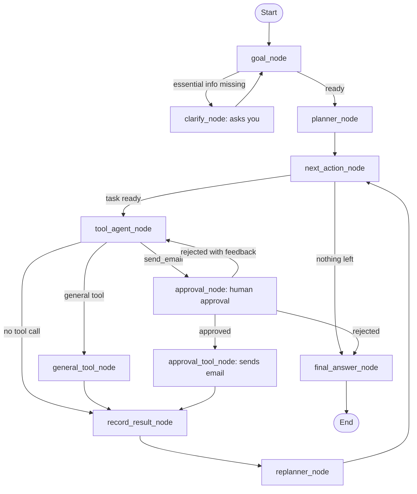

# ✈️ TaskPilot: Goal-Driven Agentic AI Assistant with Human-in-the-Loop

A **LangGraph** agent that turns one natural-language request into a plan, runs real tools (flights, weather, visa search, currency conversion, expense calculator), recovers from failures, and **asks for your approval before sending an email**.

  

## 🎯 What it does

Example request:

> *Plan a trip from Lahore to Dubai for 2 adults. Find flights with prices and timings, check the weather and visa requirements, convert the flight cost to PKR, calculate the total, and prepare an email for my manager. Show me the draft first and do not send it unless I approve.*

The agent:

1. extracts the goal (and asks you if essential information is missing),
2. plans ordered tasks,
3. picks the next task and the right tool for it,
4. records every result in the graph state,
5. retries, replaces or skips tasks that fail,
6. pauses for **human approval** before the email is sent,
7. produces a structured Markdown report.

## ✨ Features

- **Sequential agent workflow** with LangGraph state, nodes, conditional edges and structured outputs
- **Dynamic next-action routing**: the LLM chooses among tasks that are ready (no hard-coded order)
- **Human-in-the-loop approval** (`interrupt`): approve, reject, or reject with feedback and get a revised draft
- **Guaranteed approval step**: if the planner forgets the email task, or the LLM fails to produce a tool call, Python adds the task / builds the draft, so approval can never be skipped
- **Failure handling**: tool errors are detected, temporary errors are retried once, failed tasks can be replaced by alternatives or skipped, and the email still goes out with partial data
- **Checkpointing** (`InMemorySaver`) to pause and resume at approval points
- **Reliable report**: the LLM only extracts facts; numbers, tables and layout are built in Python
- **Two LLM options**: OpenRouter (default) or Gemini

## 🧩 Architecture



| Node | Responsibility |
|---|---|
| `goal_node` | Structured goal: objective, context, requirements, constraints, missing info |
| `clarify_node` | Asks you for essential missing information (max 2 rounds) |
| `planner_node` | Ordered tasks with dependencies; validates the plan (tools, cycles, one email task) |
| `next_action_node` | Finds runnable tasks; the LLM picks one when several are ready |
| `tool_agent_node` | Chooses the tool and its arguments for the current task |
| `approval_node` | Pauses with `interrupt` until you approve or reject |
| `record_result_node` | Stores each result and detects failures (also `ERROR:` strings) |
| `replanner_node` | Continue, retry, replace with alternative tasks, or skip |
| `final_answer_node` | LLM extracts facts, Python builds the report |

## 🛠️ Tools

| Tool | API | Notes |
|---|---|---|
| `search_duffel_flights` | Duffel | One-way offers, cheapest first |
| `get_weather_forecast` | OpenWeather | 5-day forecast window |
| `search_visa_requirements` | Tavily | Web search summary + sources |
| `convert_currency` | Frankfurter (fallbacks: Frankfurter v1, open.er-api.com) | Exchange rate with date and source |
| `calculate_trip_expenses` | Python `Decimal` | No LLM arithmetic |
| `send_email` | Gmail SMTP | Runs only after human approval |

## 🚀 Getting started

### Option A: Kaggle

1. Import `taskpilot.ipynb` into a Kaggle notebook and turn **Internet** on.
2. Add these **Secrets**: `OPENROUTER_API_KEY`, `DUFFEL_ACCESS_TOKEN`, `TAVILY_API_KEY`, `OPENWEATHER_API_KEY`, `SMTP_USER`, `SMTP_PASSWORD`, and optionally `MANAGER_EMAIL`.
3. Run the cells from top to bottom. The notebook asks for approval in the last cell.

### Option B: Local

```bash
git clone https://github.com/umer-ameen-ml/taskpilot-agentic-ai.git
cd taskpilot-agentic-ai
pip install -r requirements.txt
cp .env.example .env      # then fill in your keys
jupyter notebook taskpilot.ipynb
```

### Configuration

| Variable | Purpose |
|---|---|
| `LLM_PROVIDER` | `openrouter` (default) or `gemini` |
| `OPENROUTER_API_KEY`, `OPENROUTER_MODEL` | OpenRouter key and model (the model must support tool calling) |
| `GOOGLE_API_KEY`, `GEMINI_MODEL` | Gemini alternative |
| `OPENROUTER_MAX_TOKENS` | Output limit (default 4092). A high value can cause credit errors on OpenRouter |
| `DUFFEL_ACCESS_TOKEN` | Flight search |
| `TAVILY_API_KEY` | Visa search |
| `OPENWEATHER_API_KEY` | Weather |
| `SMTP_USER`, `SMTP_PASSWORD` | Gmail address and **App Password** (not your normal password) |
| `MANAGER_EMAIL` | Where the approved email is sent (default `manager@example.com`) |

## 📄 Example output

The report always has the same shape. **The values below are illustrative** (from an offline test with mocked APIs), not a real flight quote.

<details>
<summary>Show example report</summary>

# ✈️ Dubai Trip Plan
> 📅 Tuesday, 27 October 2026 · 👥 2 adults · 🛫 LHE → DXB (one-way, economy)

## ⚠️ Recommendation: Go, with conditions

- Direct flight is cheap.
- Weather is clear.

## 🛫 Flights (cheapest first)

|  | Airline | Flight | Departs | Arrives | Duration | Stops | Total (2 adults) | Per adult | Total in PKR |
| --- | --- | --- | --- | --- | --- | --- | ---: | ---: | ---: |
| 🏆 | Air2 | 200 | 27 Oct, 08:00 | 27 Oct, 10:35 | 3h 35m | Non-stop | $199.50 USD | $99.75 USD | 55,570.73 PKR |
| ✈️ | Air3 | 300 | 27 Oct, 08:00 | 27 Oct, 10:35 | 3h 35m | Non-stop | $230.10 USD | $115.05 USD | 64,094.36 PKR |
| ✈️ | Air1 | 100 | 27 Oct, 08:00 | 27 Oct, 10:35 | 3h 35m | Non-stop | $310.00 USD | $155.00 USD | 86,350.50 PKR |

💡 **Best pick:** The cheapest direct flight is the best pick.

## 🌤️ Weather in Dubai — Tuesday, 27 October 2026

| Metric | Value |
| --- | ---: |
| ☁️ Condition | Clear sky |
| 🌡️ Temperature | 28 – 38 °C |
| 💧 Humidity | 50.0 % |
| 💨 Max wind | 10.8 km/h |
| 🌧️ Rain | 10 % chance, 0 mm |

## 🛂 Visa (Pakistani passport)

- Valid passport (6 months)
- Return ticket

💳 **Fees & time:** AED 200 for 30 days; about 48 hours.

## 💱 Currency & Budget

| Calculation | Amount |
| --- | ---: |
| 🛫 Cheapest flight (2 adults) | $199.50 USD |
| 💱 Exchange rate | 1 USD = 278.55 PKR (2026-10-21, Frankfurter v2) |
| 🛫 Flights (PKR) | 111,154.50 PKR |
| **🧮 Estimated total** | **111,154.50 PKR** |

⚠️ **Not included yet:** visa, hotel, food, local transport, other.

## 📧 Email to Manager

✅ **Sent to Umer (Manager)** after your approval.
📝 Subject: *Dubai trip plan*

## 🧭 Tips

- Carry sunscreen.
- Keep passport copies.

## 📚 Sources

- [UAE gov](https://u.ae)
- Flights: Duffel API
- Weather: OpenWeather
- Exchange rate: Frankfurter v2

---
_Prices, fees and rates change. Confirm everything on official websites before booking._

</details>

## 💸 LLM usage

A normal run with 6 tasks makes about **11 to 13 LLM calls**: goal 1, planner 1, next action 2 to 4 (only when several tasks are ready), tool agent 6, report facts 1. Failures, revisions and clarification questions add calls.

## ✅ Tests

The graph is tested offline with a scripted fake LLM and mocked HTTP and SMTP, so no API keys are needed:

```bash
pip install nbformat
python tests/offline_test.py
```

It covers the happy path, a planner that forgets the email task, an LLM that returns no tool call, approve, reject, reject with feedback, weather unavailable, missing information, and currency fallbacks.

## ⚠️ Limitations

- Duffel test tokens return **dummy flights**; use a live token for real offers.
- Flights are one-way; weather only works for the next ~5 days.
- Visa information comes from web search results. It is a starting point, not legal advice. Always check official sources.
- The budget includes only costs the tools return; hotel, food and local transport are reported as "not included yet".
- Checkpoints are in memory, so state is lost when the kernel restarts.
- Tool calling quality depends on the chosen OpenRouter model.

## 📁 Project structure

```
taskpilot-agentic-ai/
├── taskpilot.ipynb        # the agent (run top to bottom)
├── tests/offline_test.py  # offline tests (fake LLM + mocked APIs)
├── requirements.txt
├── .env.example
├── .gitignore
├── LICENSE
└── README.md
```

## 📜 License

MIT. See [LICENSE](LICENSE).
